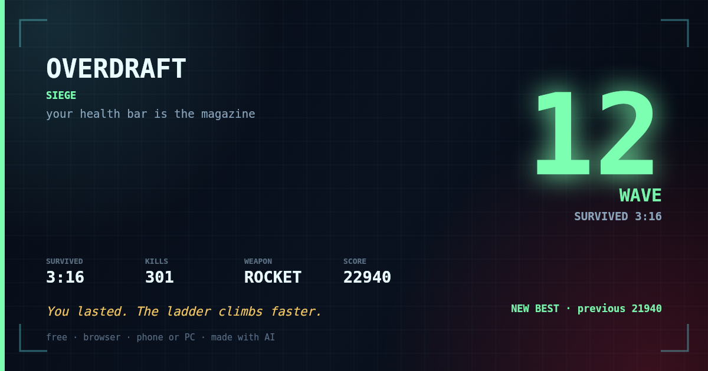

# OVERDRAFT

**Your health bar is the magazine.**

A top-down arena shooter where firing costs your own HP. Every kill pays it back.
Miss enough and you die of your own trigger finger.

Built as a submission for the **Loadout AI Game Competition** (closes 6 Nov 2026, 15:00 UTC).

---

## Play

```bash
npm start            # serves on http://localhost:5173
```

Or open the single-file build directly — no server, no dependencies:

```
dist/overdraft.html
```

| | |
|---|---|
| **Move** | WASD / arrow keys |
| **Aim** | Mouse |
| **Fire** | Left click / hold, or **J** |
| **Dash** | **Shift** (i-frames) |
| **Switch aim mode** | Tab |
| **Restart** | R |
| **Mute** | M |
| **Pause** | P |

Space is deliberately unbound. It used to fire *and* dash on the same press, so a
single key did two things and the dash went on cooldown without being asked for.

On phones: left thumb = move stick, right thumb = drag to aim + fire, tap the stick
to dash. In SIEGE the gun fires itself, so your thumbs only have to dodge.

## Three modes

| Chip | What it is |
|---|---|
| **MARKSMAN** | You aim. Misses ricochet off the wall and come back at you. |
| **AUTO-AIM** | The gun points itself; you still pull the trigger. A kill only repays the shot. |
| **SIEGE** | Endless. The gun aims *and* fires, and evolves while the waves escalate. |

Every finished run — campaign or SIEGE — is filed to a **local top-5 leaderboard**
(score, wave/level, time, accuracy). It is stored in `localStorage`, so it is
per-device; there is no backend and no account.

### SIEGE

No levels, no quota, no clock counting down. Waves arrive; clear one and the next
gets heavier. Two clocks run at once:

- **Enemies evolve every 10 seconds** — more hull, more speed, more of them, and
  new heavies (BRUTE from wave 3, ETERNAL from wave 6).
- **Your gun evolves every 20 seconds** — exactly **half as fast**:
  SINGLE → DOUBLE → TRIPLE → **ROCKET** → **TWIN ROCKET** → PIERCE ROCKET →
  ROCKET STORM.

You are always getting stronger and always falling further behind. That gap is the
mode: the run ends when it catches you.

**It is meant to be hard from wave 1.** Wave 1 arrives as a squad of four with
lancers in it, not a pair of scrappers. Bullets are free here — the health-as-ammo
economy belongs to the two campaign modes — so the pressure has to come from
elsewhere:

- **Squads arrive together, from one bearing**, and spread into a ring around you
  with a single gap that moves every wave. Standing still is not a strategy.
- **Lancers are the threat.** The gun fires itself and kills at range, so bodies
  rarely reach you; the enemies that shoot back are what actually take your PULSE.
  SIEGE lancers fire every **1.6s** instead of 1.9s and lead your movement.
- **A body contact costs 3× the campaign value.** When one does get through, you
  lose roughly a quarter of a full bar.
- **Kills do not heal you.** This was the bug that made the mode unlosable: at +1
  PULSE per kill, a 300-kill run earned back hundreds of PULSE while the enemies
  dealt a few dozen. PULSE now comes only from the refill clock and wave clears.
- **The refill is a stay of execution**: **+1 PULSE every 45 seconds** survived,
  plus **+1** per wave cleared.

Measured on a phone arena (844x390), 8 seeds per profile. Moving is what buys you
time, and dodging beats drifting:

| how you play | survives | reaches |
|---|---|---|
| never move | 52s avg | wave 4-5 (median 5) |
| drift around, no real dodging | 71s avg | wave 5-7 (median 6) |
| dodge bodies **and** lead bullets | **113s avg** | **wave 5-9 (median 7)** |

A good run is roughly two minutes and reaches wave 7. It is steep on purpose — you
are meant to be sweating by wave 4 — but it is not a wall: the first ninety seconds
are survivable and a clean player clears several waves before the ring wins.

The survival clock is the score, and the local leaderboard keeps the best five.

### Sharing a run

The death screen has a **SHARE MY RUN** button. It draws a 1200×630 PNG of the run —
hero number, mode, stats, and the verdict you just read — and hands it to your device:

- **Phone:** the native share sheet opens with the image attached, so posting to X is
  two taps. The caption is copied to your clipboard at the same time.
- **Desktop:** the file saves as `overdraft-run.png`.
- **Blocked browsers:** it falls back to opening the image in a new tab.

No upload, no account, no camera or screen-recording permission. The card is drawn
locally by `src/share.js`, which imports nothing and is unit-tested (27 checks).



### URL flags

| Flag | Does |
|---|---|
| `?demo=1` | Attract mode — a bot plays so the screen is never idle (labelled on screen) |
| `?demo=1&autostart=1` | Attract mode that skips the title screen — **this is what you record** |
| `?debug=1` | FPS + entity counter |
| `?autostart=1` | Skip the title screen |

---

## The mechanic

The whole game is one sentence: **your health bar is your magazine.**

- Every shot spends **1 PULSE**.
- Taking a hit costs **2–3 PULSE** and knocks you back.
- Every kill **refunds 2–4 PULSE** — more than the kill cost you.
- At 0 PULSE you enter **OVERDRAFT**: you can keep firing on credit down to **−3**.
- In OVERDRAFT, kills refund **1.5×**. You are always one bad hit from death.
- There is **no passive regeneration**. PULSE only comes back from kills (and, in
  SIEGE, from wave clears and the 60-second refill). If you stop shooting, you
  do not recover — you only stop paying.

This inverts the usual shooter contract. Normally you dodge and shoot independently.
Here **accuracy is survival** — a miss is the only thing that costs you health for free.
That makes the game instantly legible in a 15-second clip, which is what this
competition actually rewards.

---

## Why it is shaped this way (for the judges)

The competition scoring is **gameplay potential 40%, originality 25%, execution 20%,
development plan 15%** — not likes, not token interest.

- **Originality** comes from a single hard rule, not from content volume. No AI slop,
  no generated art, no procedurally-sprawling world. One idea that changes how you play.
- **Gameplay potential** comes from the economy being tunable and expandable (see roadmap).
- **Execution** is the part most jam entries fail: this one boots instantly in a browser,
  runs at a locked 60Hz fixed step, is deterministic per seed, has synthesized audio
  (zero asset loading), and is covered by tests.

---

## Tech

Zero dependencies. No build step required to play.

```
index.html          canvas + CRT overlay
src/sim.js          pure simulation, 1/60 fixed step, seeded RNG, no DOM
src/render.js       Canvas2D renderer, glow sprites cached at runtime
src/audio.js        WebAudio synthesis — every sound is generated, no files
src/main.js         input, loop, attract-mode bot
build.mjs           inlines everything into dist/overdraft.html
tests/headless.mjs  balance + determinism + rules assertions (Node)
tests/smoke-dom.mjs renderer + loop smoke test against a stubbed canvas (Node)
```

```bash
npm test         # both suites, no browser needed
npm run build    # dist/overdraft.html, single file, ~217 KB raw / ~68 KB gzipped
```

The simulation is DOM-free on purpose: it means the balance can be measured instead
of guessed. Current headless results:

- a bot that stands still dies in ~11s
- a competent bot reaches wave 6 and ~59% accuracy before dying
- a blind-spray bot dies roughly twice as fast at ~30% accuracy

**Accuracy is the difficulty curve.** That is the whole point.

---

## What is deliberately not here yet

Being honest about scope is part of the pitch:

- **No meta-progression.** No unlocks, no persistent currency, no leaderboard.
- **No content breadth.** One arena, 4 enemy types, 6 augments.
- **No art pipeline.** Everything is vector/Canvas2D by design (it reads as a style,
  not a limitation, but it is a choice forced by a 1-day build).
- **No mobile polish pass.** It works on touch; it was not tuned on a real phone.

## Roadmap (the 15% "development plan" criterion)

1. **Week 1 — depth:** debt spirals (bankruptcy multiplier), a 5th enemy that steals
   PULSE instead of damaging you, and a boss that only dies if you are solvent.
2. **Week 2 — retention:** daily seeded run, global accuracy leaderboard, and
   "no-miss" achievements that reward the core skill.
3. **Week 3–4 — content:** 3 arenas with distinct PULSE economies, 12 augments,
   weapon archetypes that price shots differently (a 3-cost railgun vs a 0.5-cost SMG).
4. **Later:** a proper art pass, gamepad support, and a Steam demo build.

The mechanic is the product. Everything above is content wrapped around it.

---

## AI usage (competition requirement)

- Game design, scope decisions, balance targets, and the judging read were done with AI.
- All code was written with AI assistance and reviewed by hand.
- All art, audio, and text are generated at runtime or written for this project.
  No third-party assets, no ripped sprites, no stock sound packs.

---

MIT licensed (code).
